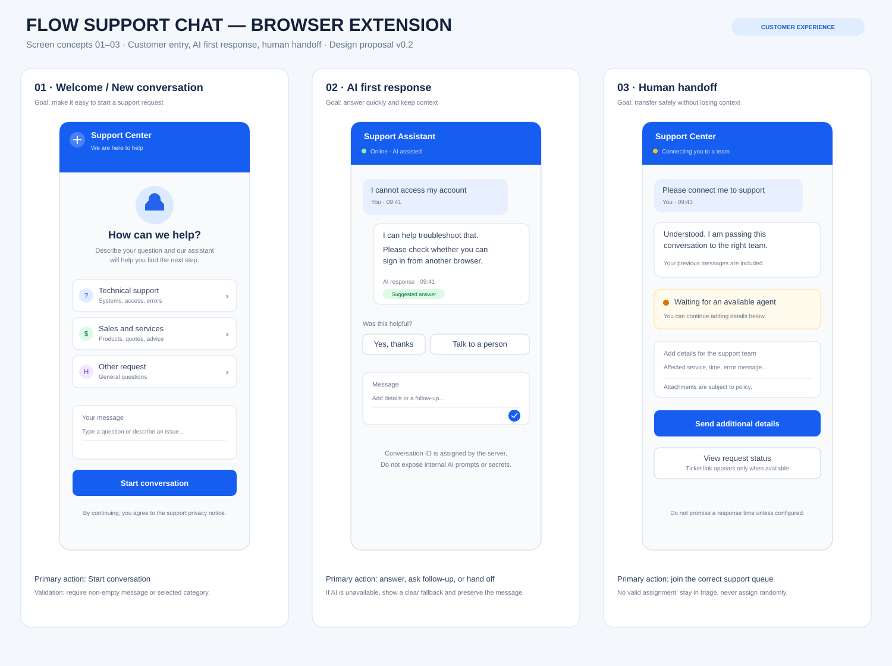
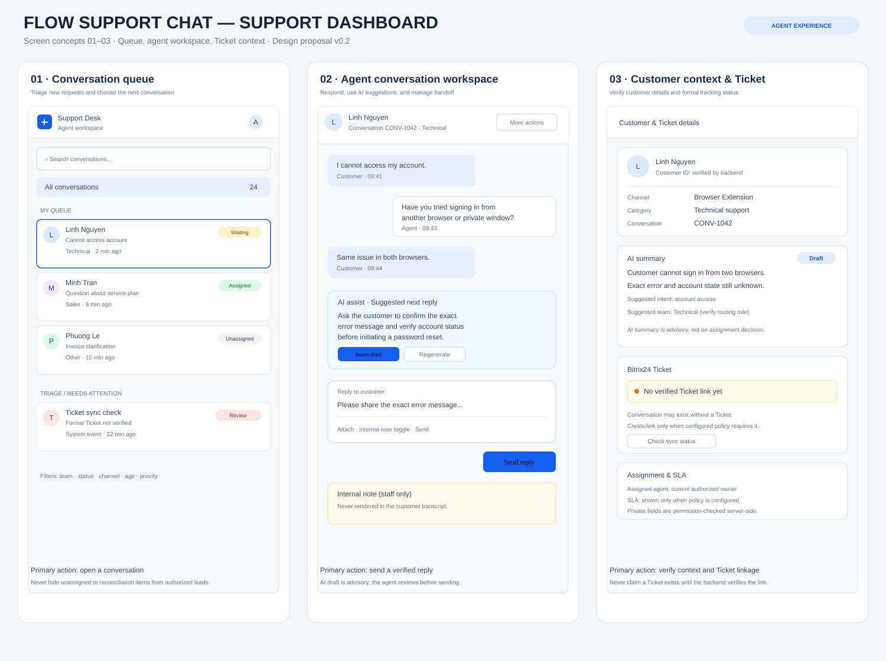

# Flow_Support_Chat

Tài liệu nghiệp vụ, kỹ thuật và UI/UX cho Browser Extension Chat Support, AI First Response, định tuyến, phân công nhân sự và tích hợp Bitrix24.

## UI/UX — Hình ảnh giao diện mẫu

Đây là **concept mockup** để thống nhất hướng thiết kế; số liệu, tên mẫu và trạng thái minh họa không phải dữ liệu production hoặc chính sách nghiệp vụ đã được phê duyệt.

[Mở hình ảnh giao diện SVG riêng](docs/assets/flow-support-ui-overview.svg)

### Browser Extension — thiết kế chi tiết

- [Đặc tả từng màn hình và luồng xử lý Browser Extension](docs/10-browser-extension-screen-specifications.md)
- [Mở hình giao diện Extension riêng](docs/assets/flow-support-extension-screens.svg)

### Support Dashboard — thiết kế chi tiết

- [Đặc tả màn hình và luồng xử lý Support Dashboard](docs/11-support-dashboard-screen-specifications.md)
- [Mở hình Support Dashboard riêng](docs/assets/flow-support-dashboard-screens.svg)

## Bộ tài liệu cho đội Dev

### Nghiệp vụ và kỹ thuật
1. [01 — Đặc tả nghiệp vụ tổng thể](docs/01-business-workflow-specification.md) — Luồng nghiệp vụ, vai trò, ngoại lệ, bảo mật và quyết định còn mở.
2. [02 — Đặc tả yêu cầu chức năng](docs/02-functional-requirements.md) — Yêu cầu có ID theo module và yêu cầu phi chức năng.
3. [03 — Bảng quyết định và chuyển trạng thái](docs/03-decision-tables-and-state-transitions.md) — Routing, assignment, Ticket, retry và lifecycle.
4. [04 — Kịch bản nghiệm thu chi tiết](docs/04-acceptance-test-scenarios.md) — 26 kịch bản test baseline.
5. [05 — Implementation Blueprint cho Dev](docs/05-implementation-blueprint.md) — Ranh giới module, trình tự handoff, kiến trúc logic, API draft, lỗi, Definition of Done và kế hoạch sprint.
6. [06 — API & Data Contract Draft](docs/06-api-and-data-contract-draft.md) — API paths, payload mẫu, DTO logic, error codes và quyết định cần chốt trước OpenAPI.

### UI/UX
7. [07 — UI Design System](docs/07-ui-design-system.md) — Palette đề xuất, typography, spacing, component catalog, responsive, accessibility và các quyết định mở.
8. [08 — Screen Inventory & User Flows](docs/08-screen-inventory-and-user-flows.md) — Danh sách màn hình Extension, Support Dashboard, Admin Portal; user flows, UI states và traceability.
9. [09 — UI/UX Implementation & Review Checklist](docs/09-ui-ux-implementation-checklist.md) — Definition of Ready/Done, UI test matrix và delivery gates.

## Cách sử dụng

- Product Owner/nghiệp vụ: xác nhận các mục OPEN, ma trận M-Tech Care, policy Ticket, SLA, quyền và các đề xuất UI/UX.
- Tech Lead: duyệt architecture decision records, API contract, object Bitrix24 và stack frontend.
- Designer/Frontend: dùng tài liệu 07–09 và hình mockup làm baseline để review; màu sắc và bố cục vẫn là đề xuất, không phải brand guideline đã được duyệt.
- Developer: triển khai theo requirement ID/module; không tự suy diễn quyết định còn mở.
- QA: dùng tài liệu 03, 04 và 09; ghi môi trường, build/version, PASS/FAIL, bằng chứng và defect ID.

## Trạng thái dự án

Đã có baseline nghiệp vụ, chức năng, acceptance tests, implementation blueprint, API/data contract draft, UI/UX design proposal và **hình concept giao diện mẫu**. Mockup chưa phải prototype tương tác được duyệt hoặc code giao diện thực tế. Chưa có schema database/OpenAPI contract cuối cùng trong bộ tài liệu này.

Trước khi chốt UI production và triển khai tích hợp Bitrix24, cần xác minh: framework frontend và browser target; auth/session; realtime transport; role matrix; loại đối tượng Ticket, field/status mapping và quyền API Bitrix24; ma trận nhân sự thực tế; SLA, file policy và kênh phản hồi. Không hard-code các quyết định chưa được duyệt.
