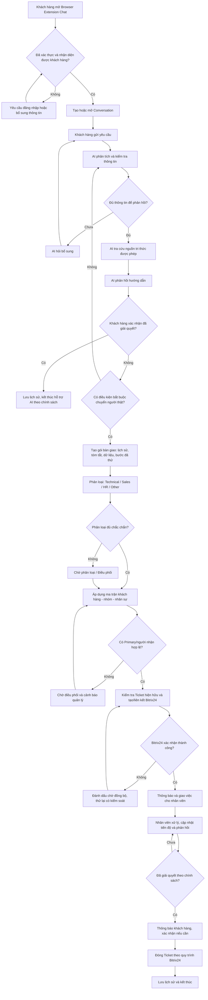

# Flow Support Chat — Đặc tả nghiệp vụ

- Phiên bản: 1.0
- Ngày cập nhật: 2026-10-19
- Trạng thái: Bản phân tích nghiệp vụ để đội nghiệp vụ và Dev thống nhất
- Phạm vi: Browser Extension Chat Support, AI First Response, định tuyến nhóm hỗ trợ, phân công cố định M-Tech Care và tích hợp Ticket Bitrix24.

## 1. Mục tiêu tài liệu

Tài liệu mô tả hệ thống phải vận hành như thế nào từ lúc khách hàng gửi yêu cầu đến khi yêu cầu được giải quyết và đóng. Đây là đặc tả nghiệp vụ, không phải thiết kế API, database hoặc mã nguồn.

Tài liệu dùng để:
1. Thống nhất cách vận hành giữa nghiệp vụ, IT vận hành và đội Dev.
2. Làm căn cứ thiết kế chức năng, trạng thái, phân quyền và tích hợp Bitrix24.
3. Làm căn cứ viết test case và nghiệm thu.
4. Tách các quy tắc có thể cấu hình khỏi logic cố định của chương trình.

## 2. Phạm vi hệ thống

### 2.1 Trong phạm vi
- Khách hàng mở Browser Extension và trao đổi qua Chat.
- Nhận diện khách hàng/đơn vị theo danh tính đã xác thực.
- AI phân tích yêu cầu, hỏi bổ sung, tra cứu nguồn tri thức được phép và đưa ra phản hồi đầu tiên.
- Quyết định tiếp tục hỗ trợ bằng AI hay chuyển nhân viên.
- Phân loại yêu cầu: Technical, Sales, HR, Other/Unclassified.
- Áp dụng ma trận nhân sự cố định cho từng khách hàng M-Tech Care.
- Tạo hoặc liên kết Ticket trên Bitrix24, đồng bộ trạng thái và lưu liên kết với hội thoại.
- Nhân viên xử lý, phối hợp, cập nhật tiến độ và phản hồi khách hàng.
- Quản lý lỗi, chuyển cấp, lịch sử kiểm toán và tiêu chí nghiệm thu.

### 2.2 Ngoài phạm vi ở giai đoạn này
- Chốt schema database, tên bảng và migration.
- Đặc tả endpoint/API cụ thể.
- Chọn chính xác loại đối tượng Bitrix24 (Tasks, CRM, Smart Process hoặc Ticket module hiện hữu).
- Thiết kế giao diện chi tiết từng màn hình.
- Chốt SLA thực tế, thời gian timeout và chính sách tự đóng.
- Tự động thực hiện các hành động quản trị nhạy cảm bằng AI.

## 3. Thuật ngữ và khái niệm

| Thuật ngữ | Ý nghĩa nghiệp vụ |
|---|---|
| Conversation / Hội thoại | Luồng trao đổi giữa khách hàng, AI và nhân viên trong Chat. |
| Message / Tin nhắn | Một nội dung đơn lẻ trong hội thoại, có tác giả và thời điểm. |
| Ticket | Hồ sơ yêu cầu cần theo dõi công việc, trạng thái, người chịu trách nhiệm và SLA trên Bitrix24. |
| Routing / Định tuyến | Xác định nhóm hoặc hàng đợi có trách nhiệm xử lý yêu cầu. |
| Assignment / Phân công | Gán người chịu trách nhiệm và/hoặc người thực hiện. |
| Primary | Đầu mối phụ trách chính theo ma trận nghiệp vụ của khách hàng/nhóm. |
| Technical/Business Owner | Người trực tiếp xử lý theo chuyên môn. Có thể trùng Primary nếu được cấu hình. |
| Backup | Người thay thế hoặc hỗ trợ khi Primary/người xử lý không khả dụng. |
| Triage / Chờ phân loại | Trạng thái dành cho yêu cầu chưa rõ nhóm hoặc chưa xác định được người nhận phù hợp. |
| AI Handoff | Chuyển từ AI sang hỗ trợ người thật, đồng thời bàn giao đủ bối cảnh. |
| SLA | Cam kết thời gian phản hồi/xử lý theo loại dịch vụ và mức ưu tiên, nếu áp dụng. |
| Idempotency / Chống xử lý trùng | Cơ chế đảm bảo thao tác thử lại không tạo nhiều Ticket cho cùng một yêu cầu. |

## 4. Vai trò tham gia

| Vai trò | Trách nhiệm |
|---|---|
| Khách hàng | Gửi yêu cầu, bổ sung thông tin, nhận phản hồi và xác nhận kết quả khi được yêu cầu. |
| AI Agent | Phân tích, hỏi bổ sung, tra cứu tri thức, phản hồi trong giới hạn cho phép, đề xuất nhóm và tóm tắt bàn giao. |
| Routing Engine | Áp dụng quy tắc nghiệp vụ đã cấu hình để xác định nhóm, ưu tiên và đích phân công. |
| Nhân viên Primary | Theo dõi trách nhiệm chính và bảo đảm yêu cầu có người tiếp tục xử lý theo mô hình vận hành đã thống nhất. |
| Người xử lý chuyên môn | Thực hiện xử lý kỹ thuật hoặc nghiệp vụ. |
| Backup | Thay thế/hỗ trợ theo quy tắc vắng mặt, quá tải hoặc chuyển giao. |
| Điều phối/Quản lý | Xử lý trường hợp không phân loại được, không có người phù hợp, vượt quyền hoặc có nguy cơ SLA. |
| Bitrix24 | Nguồn dữ liệu chính thức cho Ticket và trạng thái xử lý công việc theo cấu hình tích hợp được chốt. |
| Quản trị hệ thống | Quản lý danh sách khách hàng, ma trận phân công, nhóm, quy tắc và quyền truy cập. |

## 5. Nguyên tắc nghiệp vụ cốt lõi

1. **Một yêu cầu — một hồ sơ theo dõi chính:** Trước khi tạo Ticket mới, phải kiểm tra Ticket hiện hữu có liên quan; không tạo trùng do gửi lại hoặc timeout.
2. **Hội thoại và Ticket là hai đối tượng khác nhau:** Hội thoại lưu giao tiếp; Ticket quản lý công việc. Chúng phải liên kết được nhưng vòng đời có thể khác nhau.
3. **Bitrix24 là nguồn chuẩn cho Ticket:** Dịch vụ Chat lưu mã liên kết, trạng thái đồng bộ và dữ liệu hội thoại; không tạo một hệ Ticket độc lập cạnh tranh với Bitrix24.
4. **AI đề xuất, quy tắc quyết định:** AI có thể đề xuất nhóm/ưu tiên; hệ thống áp dụng ma trận và quy tắc đã cấu hình. Trường hợp thiếu chắc chắn phải đưa vào Triage.
5. **Không mất ngữ cảnh khi bàn giao:** Nhân viên phải xem được nội dung khách đã gửi, tóm tắt AI, thông tin đã thu thập và các bước đã hướng dẫn.
6. **Không gán nhầm khách hàng hoặc để lộ dữ liệu:** Mọi truy xuất hội thoại/Ticket phải kiểm tra danh tính và quyền truy cập.
7. **Không xác nhận điều chưa xảy ra:** Chỉ thông báo “đã tạo Ticket” sau khi hệ thống xác nhận Bitrix24 đã tạo hoặc đã liên kết Ticket thành công.
8. **Ma trận M-Tech Care phải có thể quản trị:** Danh sách nhân sự theo khách hàng/nhóm không được mặc định cứng trong code.
9. **Nhân viên và hệ thống đều phải ghi nhận sự kiện:** Chuyển nhóm, gán người, đổi trạng thái, thử đồng bộ và đóng Ticket cần có lịch sử.
10. **AI không tự thực hiện hành động nhạy cảm:** Hành động cần quyền quản trị/phê duyệt phải chuyển người có thẩm quyền.

## 6. Luồng nghiệp vụ tổng thể

## 7. Đặc tả nghiệp vụ theo bước

### B1 — Khách hàng mở Chat và xác thực

**Mục tiêu:** Mở đúng phiên hội thoại trong đúng phạm vi khách hàng.

**Luồng chính**
1. Khách hàng mở extension.
2. Hệ thống kiểm tra trạng thái đăng nhập/token theo cơ chế xác thực được thiết kế sau.
3. Nếu đã xác thực, hệ thống xác định danh tính, công ty/đơn vị, quyền truy cập và ngữ cảnh dịch vụ.
4. Nếu chưa xác thực hoặc danh tính không đủ rõ, yêu cầu đăng nhập/bổ sung thông tin; không tự gán danh tính dựa trên nội dung người dùng tự khai mà không xác minh.
5. Hệ thống tạo Conversation mới hoặc mở Conversation cũ mà người dùng có quyền xem.
6. Giao diện hiển thị lịch sử phù hợp với quyền của người dùng.

**Ngoại lệ**
- Hết hạn phiên: yêu cầu xác thực lại; không xóa lịch sử đã lưu.
- Không tìm thấy mapping khách hàng: chuyển trạng thái cần xác minh; không tự gán sang đơn vị khác.
- Không có quyền truy cập hội thoại cũ: từ chối truy cập và ghi log bảo mật.

**Kết quả:** Conversation có định danh ổn định, thuộc đúng khách hàng và có thể tiếp nhận Message.

### B2 — Tiếp nhận và phân tích yêu cầu

1. Lưu tin nhắn đầu vào và thông tin cần thiết như thời gian, tác giả, Conversation ID.
2. AI phân tích ý định, dịch vụ liên quan, mức độ khẩn cấp sơ bộ và thông tin còn thiếu.
3. Nếu thiếu dữ kiện cần thiết, AI hỏi từng câu ngắn, cụ thể; không hỏi lại những dữ liệu đã có trong hội thoại.
4. Khi đã đủ dữ kiện, AI tìm kiếm nguồn tri thức được phép sử dụng.
5. AI chỉ trả lời theo căn cứ khả dụng; nếu nguồn thiếu, mâu thuẫn hoặc không đủ tin cậy, phải nêu giới hạn và chuyển người khi cần.
6. Nội dung AI gửi khách và kết quả tra cứu phục vụ bàn giao phải được lưu theo chính sách lưu trữ.

**Ví dụ thông tin kỹ thuật nên thu thập khi có liên quan:** dịch vụ/hệ thống bị ảnh hưởng, thiết bị/người dùng bị ảnh hưởng, thời điểm bắt đầu, thông báo lỗi, hành động đã thử, ảnh chụp/file đính kèm. Chỉ thu thập thông tin cần thiết cho từng loại yêu cầu.

### B3 — Quyết định AI tiếp tục hay chuyển người thật

**Chuyển người thật khi có một trong các điều kiện:**
- Khách hàng yêu cầu nhân viên.
- Khách hàng báo rằng hướng dẫn chưa giải quyết được vấn đề sau vòng hỏi/hướng dẫn phù hợp.
- AI không tìm được căn cứ phù hợp hoặc thiếu khả năng xử lý.
- Yêu cầu cần quyền quản trị, phê duyệt hoặc có rủi ro bảo mật.
- Yêu cầu cần ưu tiên do ảnh hưởng rộng, gián đoạn dịch vụ hoặc nguy cơ SLA.
- Yêu cầu được xác định thuộc luồng cần người phụ trách như Sales/HR theo chính sách.

**Nếu AI có vẻ giải quyết được:**
1. Tóm tắt cách xử lý.
2. Hỏi khách hàng xác nhận.
3. Nếu khách hàng đồng ý, lưu kết quả và kết thúc hỗ trợ AI.
4. Nếu khách hàng không đồng ý/chưa phản hồi, áp dụng chính sách số lần nhắc và thời gian chờ sau khi nghiệp vụ chốt; cho phép yêu cầu người thật theo chính sách.

**Lưu ý:** Không dùng một ngưỡng confidence duy nhất cho mọi intent nếu chưa được kiểm nghiệm. Ngưỡng, số vòng hỏi và thời gian chờ cần là cấu hình theo loại yêu cầu.

### B4 — Tạo gói bàn giao từ AI sang nhân viên

Khi chuyển người thật, hệ thống chuẩn bị một gói bàn giao gồm:
- Conversation ID và khách hàng/đơn vị đã xác thực.
- Yêu cầu ban đầu của khách hàng.
- Tóm tắt vấn đề theo ngôn ngữ rõ ràng.
- Loại yêu cầu và nhóm AI đề xuất, kèm lý do/độ chắc chắn nếu có.
- Dịch vụ, phạm vi ảnh hưởng, độ ưu tiên đề xuất.
- Thông tin đã hỏi và câu trả lời nhận được.
- Các bước hướng dẫn đã đưa ra và kết quả khách phản hồi.
- File đính kèm có quyền truy cập phù hợp.
- Các rủi ro, thông tin còn thiếu và câu hỏi cần nhân viên tiếp tục làm rõ.
- Mã Ticket Bitrix24 nếu đã tồn tại.

Nhân viên không được yêu cầu khách hàng lặp lại thông tin đã có, trừ khi cần xác minh lại vì lý do bảo mật hoặc thông tin mâu thuẫn.

### B5 — Phân loại nhóm

| Nhóm | Bao gồm | Ví dụ | Xử lý khi không chắc chắn |
|---|---|---|---|
| Technical | Sự cố, cấu hình, vận hành dịch vụ CNTT | Mạng, PC, máy chủ, NAS, tài khoản, ứng dụng | Triage nếu chưa biết hệ thống/dịch vụ |
| Sales | Tư vấn, mua mới, báo giá, hợp đồng, gia hạn | Hỏi gói dịch vụ, báo giá, điều khoản hợp đồng | Chuyển Sales hoặc Triage theo ma trận được phê duyệt |
| HR | Tuyển dụng, chính sách, thủ tục nhân sự | Quy trình tuyển dụng, thủ tục nội bộ | Chuyển HR có quyền phù hợp |
| Other | Hành chính hoặc yêu cầu ngoài các nhóm trên | Yêu cầu điều phối chung | Giao hàng đợi chung |
| Unclassified/Triage | Nội dung mơ hồ, nhiều intent hoặc thiếu căn cứ | “Tôi cần hỗ trợ việc này” chưa rõ việc gì | Điều phối viên phân loại |

**Quy tắc phân loại**
1. AI đề xuất intent/group, không tự cấp quyền hoặc tự thực hiện hành động.
2. Routing Engine kiểm tra quy tắc rõ ràng và ma trận được cấu hình.
3. Nếu yêu cầu chứa nhiều việc độc lập, nhân viên/điều phối quyết định tách hay giữ chung; không tự động tạo nhiều Ticket nếu chưa có quy tắc.
4. Khi nhóm được sửa thủ công, lưu nhóm cũ, nhóm mới, người sửa, thời gian và lý do.
5. Yêu cầu nhạy cảm chỉ hiển thị cho nhóm/người có quyền.

### B6 — Phân công cố định M-Tech Care

**Cấu hình tối thiểu theo nghiệp vụ**
- Khách hàng/đơn vị.
- Nhóm hỗ trợ.
- Primary (đầu mối chính).
- Người xử lý chuyên môn hoặc nhóm xử lý.
- Backup.
- Người/cấp quản lý nhận escalation.
- Trạng thái hiệu lực và khoảng thời gian có hiệu lực.
- Quy tắc áp dụng khi người nhận không khả dụng.

**Thuật toán nghiệp vụ đề xuất**
1. Tìm mapping có hiệu lực theo khách hàng + nhóm yêu cầu.
2. Kiểm tra Primary còn hoạt động và có quyền hỗ trợ khách hàng/nhóm đó.
3. Nếu Primary khả dụng, gán theo mapping.
4. Nếu Primary không khả dụng, áp dụng Backup hoặc escalation đã cấu hình.
5. Nếu không có mapping hợp lệ, để ở Triage/Unassigned và báo điều phối viên; không chọn ngẫu nhiên.
6. Ghi lý do gán, nguồn quy tắc và thời điểm gán.
7. Khi thay đổi người nhận, giữ lịch sử phân công trước đó.

**Phân biệt trách nhiệm**
- Primary là đầu mối và chịu trách nhiệm theo dõi theo mô hình đã cấu hình.
- Người xử lý chuyên môn giải quyết nội dung chuyên môn.
- Backup thay thế/hỗ trợ theo điều kiện kích hoạt.
- Người quản lý xử lý trường hợp quá hạn, không có người nhận hoặc vượt quyền.

Không mặc định Primary kỹ thuật là người thực hiện Sales/HR. Mỗi nhóm cần mapping đúng chuyên môn.

### B7 — Tạo hoặc liên kết Ticket Bitrix24

**Trước khi tạo**
1. Kiểm tra Conversation đã có Ticket liên kết chưa.
2. Nếu có Ticket đang mở cho cùng yêu cầu, liên kết tiếp vào Ticket đó theo chính sách.
3. Nếu khách báo lại một vấn đề khác hoặc một yêu cầu độc lập, áp dụng quy tắc phân tách đã thống nhất.
4. Nếu chưa có Ticket và yêu cầu cần theo dõi, gửi yêu cầu tạo Ticket sang Bitrix24.

**Thông tin đề nghị truyền sang Ticket**
- Tiêu đề ngắn, mô tả đầy đủ.
- Khách hàng/đơn vị và dịch vụ liên quan.
- Nhóm/loại yêu cầu, mức ưu tiên.
- Conversation ID và liên kết mở hội thoại.
- Tóm tắt AI, các bước đã thử, thông tin còn thiếu.
- Primary, người xử lý và Backup theo mapping.
- Thời điểm tiếp nhận, SLA theo quy tắc đã chốt.
- Nguồn tiếp nhận: Browser Extension Chat.

**Xử lý kết quả**
- Thành công: lưu Bitrix Ticket ID và liên kết; mới được thông báo Ticket đã tạo.
- Timeout/kết quả không rõ: đánh dấu Pending Reconciliation; đối chiếu Bitrix24 trước khi retry.
- Lỗi xác thực/quyền/validation: lưu nguyên nhân, cảnh báo vận hành và chuyển xử lý; không retry vô hạn.
- Thử lại phải có cơ chế chống tạo trùng và giới hạn tần suất.
- Không được coi trạng thái local là bằng chứng duy nhất cho trạng thái Ticket trên Bitrix24.

**Điểm phải xác nhận trước khi thiết kế tích hợp:** loại đối tượng Bitrix24 dùng cho Ticket; trường bắt buộc; cách gán người/nhóm; quy tắc trạng thái; cách tra cứu Ticket hiện hữu; API/quyền tích hợp; chính sách comment công khai so với ghi chú nội bộ.

### B8 — Nhân viên xử lý

1. Nhân viên nhận thông báo.
2. Mở Ticket và truy cập Conversation theo quyền.
3. Xác nhận tiếp nhận; trạng thái Ticket được cập nhật theo mapping Bitrix24.
4. Đọc gói bàn giao và lịch sử.
5. Xử lý hoặc phối hợp nhóm khác.
6. Mọi yêu cầu bổ sung thông tin được gửi khách qua kênh được hỗ trợ và ghi nhận trong lịch sử phù hợp.
7. Cập nhật tiến độ, kết quả, nguyên nhân và bước tiếp theo vào Ticket.
8. Nếu chuyển nhóm/người, ghi lý do và bảo đảm có chủ sở hữu tiếp theo trước khi bỏ người hiện tại.
9. Nếu cần chờ khách hàng/bên thứ ba, chuyển trạng thái chờ tương ứng theo quy ước.
10. Khi hoàn tất, ghi rõ kết quả giải quyết, không chỉ đổi trạng thái.

### B9 — Thông báo và cập nhật đồng bộ

Các sự kiện có thể tạo thông báo:
- Yêu cầu đã được tiếp nhận.
- Ticket đã được tạo/gắn mã.
- Ticket được giao cho nhân viên.
- Ticket được chuyển nhóm/người.
- Nhân viên đã phản hồi hoặc có cập nhật tiến độ.
- Cần khách hàng bổ sung thông tin.
- Yêu cầu đã giải quyết/đóng.
- Có sự cố tích hợp làm chậm xử lý.

**Quy tắc**
- Chỉ gửi thông báo sau khi sự kiện nền tương ứng được xác nhận.
- Không gửi thông báo lặp vô hạn khi worker retry.
- Không đưa ghi chú nội bộ, dữ liệu nhạy cảm hay thông tin khách hàng khác vào thông báo công khai.
- Vì Browser Extension có thể không chạy liên tục, việc xử lý Ticket và gửi các thông báo quan trọng không được phụ thuộc hoàn toàn vào vòng đời của extension.

### B10 — Xác nhận và đóng

1. Nhân viên đánh dấu đã giải quyết và ghi kết quả.
2. Hệ thống gửi thông báo cho khách hàng.
3. Nếu chính sách yêu cầu xác nhận, chờ phản hồi trong thời gian đã cấu hình.
4. Khách hàng xác nhận: đóng Ticket theo quy trình Bitrix24.
5. Khách hàng báo chưa giải quyết: chuyển Ticket về trạng thái xử lý hoặc mở lại theo khả năng của đối tượng Bitrix24.
6. Không có phản hồi: áp dụng chính sách chờ/tự đóng đã được duyệt; không tự giả định khách hàng hài lòng.
7. Ghi lịch sử thời điểm giải quyết, đóng, người thực hiện và lý do.
8. Hội thoại có thể vẫn đọc được sau khi Ticket đóng theo quyền và chính sách lưu trữ.

## 8. Mô hình trạng thái

### 8.1 Conversation (đề xuất)
- Open: đang trao đổi.
- AI_HANDLING: AI đang xử lý.
- WAITING_CUSTOMER: chờ khách hàng bổ sung/xác nhận.
- HUMAN_HANDOFF: đang bàn giao cho người thật.
- HUMAN_HANDLING: nhân viên đang xử lý thông qua Chat.
- RESOLVED: nội dung hội thoại đã giải quyết.
- CLOSED: kết thúc hội thoại theo chính sách.

Đây là trạng thái đề xuất cho lớp hội thoại; có thể rút gọn khi thiết kế kỹ thuật, nhưng không được dùng lẫn với trạng thái Ticket.

### 8.2 Ticket
Ticket sử dụng trạng thái thực tế do đối tượng Bitrix24 được chọn hỗ trợ. Mapping nghiệp vụ đề xuất:

| Trạng thái nghiệp vụ | Ý nghĩa |
|---|---|
| New | Đã tạo, chưa xác nhận tiếp nhận |
| Accepted | Có người/nhóm nhận trách nhiệm |
| In Progress | Đang xử lý |
| Waiting Customer | Chờ khách hàng cung cấp thông tin/xác nhận |
| Waiting Third Party | Chờ nhà cung cấp/đơn vị khác |
| Resolved | Đã có kết quả giải quyết |
| Closed | Hồ sơ đã đóng |
| Cancelled | Hủy theo điều kiện và lý do được phép |

Mapping này chỉ là chuẩn nghiệp vụ đề xuất; phải ánh xạ sang status thực tế của Bitrix24 sau khi loại đối tượng được xác nhận.

### 8.3 Trạng thái đồng bộ Bitrix24
- NOT_REQUIRED: chưa cần Ticket theo chính sách.
- PENDING_CREATE: chờ tạo.
- SYNCING: đang gửi yêu cầu.
- SYNCED: đã nhận xác nhận và có Ticket ID.
- RETRY_WAIT: lỗi tạm thời, chờ thử lại.
- RECONCILIATION_REQUIRED: kết quả không rõ; cần đối chiếu để chống tạo trùng.
- FAILED_REQUIRES_ACTION: lỗi cần can thiệp vận hành.

Trạng thái đồng bộ không được ghi đè hoặc thay thế trạng thái nghiệp vụ Ticket.

## 9. Ma trận quyết định tạo Ticket

| Tình huống | Hành động đề xuất | Ghi chú |
|---|---|---|
| Câu hỏi phổ thông, AI trả lời được, khách xác nhận | Chỉ lưu Conversation, không bắt buộc Ticket | Theo chính sách dịch vụ |
| AI không xử lý được, cần nhân viên | Tạo hoặc liên kết Ticket | Không yêu cầu khách nhập lại |
| Sự cố cần SLA/audit | Tạo Ticket | Mức SLA phải lấy từ cấu hình |
| Yêu cầu Sales/HR cần người theo dõi | Tạo hồ sơ theo đối tượng Bitrix24 được chọn | Cần thống nhất có dùng chung Ticket type hay không |
| Conversation đã liên kết Ticket đang mở | Dùng Ticket hiện tại nếu cùng yêu cầu | Tránh trùng |
| Tạo Ticket timeout | Đối chiếu trước khi thử lại | Không mặc định thất bại |
| Khách gửi yêu cầu mới độc lập trong cùng Conversation | Triage/đánh giá tách Ticket | Không tự động gộp hoặc tách nếu chưa có quy tắc |

## 10. Ưu tiên, SLA và escalation

**Không tự đặt con số SLA trong code trước khi nghiệp vụ duyệt.**

Quy tắc đề xuất:
1. Xác định mức ưu tiên dựa trên ảnh hưởng, tính khẩn cấp và chính sách dịch vụ.
2. SLA lấy từ ma trận dịch vụ/khách hàng/độ ưu tiên đã cấu hình.
3. Cảnh báo trước hạn, khi quá hạn và khi không có người tiếp nhận theo mốc đã phê duyệt.
4. Escalation phải có người nhận rõ ràng; nếu người nhận escalation không khả dụng thì cần lối thoát sang quản lý hệ thống/điều phối.
5. Phải xác định thời gian tính SLA: giờ làm việc hay 24/7; thời gian chờ khách hàng/bên thứ ba có tạm dừng SLA không.
6. Việc chuyển nhóm không được âm thầm làm mất lịch sử SLA. Quy tắc reset/giữ nguyên SLA cần được duyệt.

## 11. Xử lý ngoại lệ chi tiết

| Mã | Ngoại lệ | Hành động hệ thống | Kết quả mong đợi |
|---|---|---|---|
| EX01 | Extension đóng | Hội thoại/ticket đã lưu vẫn tiếp tục hoạt động phía server | Không mất yêu cầu |
| EX02 | AI timeout/lỗi | Cho phép retry có giới hạn hoặc chuyển người | Có thông báo rõ ràng |
| EX03 | AI không có căn cứ | Không trả lời chắc chắn; chuyển nhân viên khi cần | Tránh hướng dẫn sai |
| EX04 | Không nhận diện khách hàng | Yêu cầu xác thực/xác minh | Không rò dữ liệu |
| EX05 | Không rõ nhóm | Đưa vào Triage | Không phân công ngẫu nhiên |
| EX06 | Không có Primary/Backup hợp lệ | Tạo trạng thái chờ điều phối và cảnh báo | Có người chịu trách nhiệm tiếp nhận ngoại lệ |
| EX07 | Bitrix24 timeout khi tạo Ticket | Đánh dấu cần đối chiếu, tìm Ticket trước khi retry | Không tạo trùng |
| EX08 | Bitrix24 từ chối do quyền/validation | Ghi lỗi, cảnh báo vận hành, không retry vô hạn | Có hướng khắc phục |
| EX09 | Nhân viên không nhận việc | Kích hoạt Backup/escalation theo cấu hình | Không bỏ quên yêu cầu |
| EX10 | Chuyển nhầm nhóm | Chuyển nhóm, giữ nguyên hội thoại và lịch sử | Truy vết được |
| EX11 | Khách gửi thông tin bổ sung | Gắn vào đúng Conversation/Ticket | Không tạo yêu cầu trùng |
| EX12 | Ticket đóng nhưng khách phản hồi | Mở lại hoặc xử lý theo quy tắc được chốt | Không mất phản hồi |
| EX13 | Notification thất bại | Ghi nhận và retry có kiểm soát | Không chặn xử lý nghiệp vụ |
| EX14 | Dữ liệu đính kèm không an toàn/quá lớn | Kiểm tra quyền, loại và giới hạn file theo chính sách | Hạn chế rủi ro file |
| EX15 | Chuyển cấp khi vượt SLA | Thông báo cấp xử lý đã cấu hình | Có dấu vết cảnh báo |

## 12. Quyền truy cập và bảo mật nghiệp vụ

- Khách hàng chỉ xem Conversation của mình và dữ liệu được phép chia sẻ.
- Nhân viên chỉ xem khách hàng/Ticket thuộc phạm vi được giao hoặc theo quyền quản lý.
- Ghi chú nội bộ trên Ticket phải được tách khỏi tin nhắn công khai.
- AI chỉ truy xuất tri thức phù hợp với quyền của khách hàng, dịch vụ và nhân viên liên quan.
- Không đưa API key/secret của AI hoặc Bitrix24 vào extension.
- Log phải tránh ghi bí mật xác thực và dữ liệu nhạy cảm không cần thiết.
- Các thao tác thay đổi quyền, phân công, đóng/mở lại, chuyển cấp và chỉnh cấu hình cần có audit trail.
- Chính sách lưu trữ/xóa hội thoại và file đính kèm phải được duyệt; không tự suy ra thời hạn lưu giữ.

## 13. Cấu hình nghiệp vụ bắt buộc phải quản trị được

| Cấu hình | Ví dụ/ý nghĩa | Khi thay đổi |
|---|---|---|
| Customer/Organization | Định danh khách hàng và đơn vị | Kiểm soát quyền và routing |
| Service Catalog | Các dịch vụ khách đang sử dụng | Hỗ trợ phân loại và SLA |
| Support Group | Technical, Sales, HR, Other | Điều chỉnh nhóm định tuyến |
| Assignment Matrix | Khách hàng + nhóm → Primary/Owner/Backup/Escalation | Phân công tự động |
| Intent/Category Rules | Nhóm loại yêu cầu và điều kiện áp dụng | Phân loại yêu cầu |
| AI Handoff Rules | Khi nào bắt buộc chuyển người | Kiểm soát chất lượng AI |
| Priority/SLA Matrix | Mức ưu tiên, giờ tính, thời hạn, mốc cảnh báo | Tính và theo dõi SLA |
| Ticket Policy | Khi nào tạo/liên kết/tách Ticket | Kiểm soát đối tượng Bitrix |
| Bitrix Status Mapping | Trạng thái nghiệp vụ ↔ status Bitrix24 | Đồng bộ trạng thái |
| Notification Rules | Sự kiện, người nhận, kênh, retry | Thông tin đúng người |
| Access Policy | Ai xem/sửa/đóng từng loại dữ liệu | An toàn dữ liệu |

## 14. Tiêu chí nghiệm thu (Acceptance Criteria)

Mỗi test case cần ghi rõ dữ liệu đầu vào, điều kiện trước, bước thực hiện và kết quả mong đợi. Danh sách dưới đây là baseline:

| ID | Kịch bản | Kết quả mong đợi |
|---|---|---|
| AC01 | Khách hàng hợp lệ mở Chat | Tạo/mở đúng Conversation, đúng tổ chức |
| AC02 | Khách chưa xác thực | Yêu cầu xác thực; không lộ lịch sử |
| AC03 | AI giải quyết và khách xác nhận | Lưu lịch sử, kết thúc hỗ trợ AI theo chính sách |
| AC04 | Khách yêu cầu nhân viên | Handoff và giữ đầy đủ context |
| AC05 | AI thiếu thông tin | Hỏi bổ sung, không hỏi trùng dữ liệu đã cung cấp |
| AC06 | AI không chắc phân loại | Đưa Triage, không tự gán ngẫu nhiên |
| AC07 | Yêu cầu Technical M-Tech Care | Định tuyến đúng nhóm và mapping hiệu lực |
| AC08 | Yêu cầu Sales | Định tuyến Sales, không mặc định giao kỹ thuật |
| AC09 | Yêu cầu HR | Định tuyến HR và áp dụng quyền phù hợp |
| AC10 | Primary không khả dụng | Áp dụng Backup/escalation hoặc Triage |
| AC11 | Không có assignment mapping | Không tự gán người ngoài danh sách; tạo cảnh báo |
| AC12 | Handoff đã có Ticket hiện hữu | Liên kết Ticket đúng, không tạo trùng |
| AC13 | Tạo Ticket Bitrix thành công | Lưu Ticket ID và gửi thông báo chính xác |
| AC14 | Tạo Ticket bị timeout | Đối chiếu trước retry, không tạo trùng |
| AC15 | Bitrix trả lỗi quyền/validation | Ghi lỗi, cảnh báo; không retry vô hạn |
| AC16 | Nhân viên cập nhật tiến độ | Cập nhật đúng trạng thái và lịch sử |
| AC17 | Chuyển nhóm/người xử lý | Lưu lý do và giữ lịch sử |
| AC18 | Ticket chờ khách hàng | Thông báo và áp dụng chính sách chờ |
| AC19 | Ticket đã giải quyết | Có ghi nhận kết quả và thông báo khách |
| AC20 | Khách phản hồi chưa giải quyết | Quay lại xử lý/mở lại theo quy tắc |
| AC21 | SLA có nguy cơ/vượt hạn | Cảnh báo đúng cấp và ghi audit |
| AC22 | Thử truy cập dữ liệu khách khác | Bị từ chối và ghi log bảo mật |
| AC23 | Browser Extension không chạy | Ticket và các tác vụ server-side vẫn hoạt động |
| AC24 | Thông báo lỗi | Retry kiểm soát, không gửi trùng liên tục |

## 15. Các quyết định còn mở — cần nghiệp vụ xác nhận

Đây là các mục chưa được coi là quyết định cuối cùng. Dev không nên tự chọn mà không ghi lại quyết định:

| ID | Câu hỏi cần chốt | Khuyến nghị ban đầu |
|---|---|---|
| D01 | Bitrix24 dùng loại đối tượng nào làm Ticket? | Khảo sát hệ thống Bitrix hiện tại, ưu tiên đối tượng đã có quy trình vận hành |
| D02 | Khi nào tạo Ticket: ngay từ đầu hay khi chuyển người thật? | Tạo khi yêu cầu cần theo dõi/nhân viên/SLA; chat FAQ có thể không tạo Ticket |
| D03 | Primary có phải đầu mối cho mọi yêu cầu Sales/HR không? | Có thể là đầu mối theo dõi chung nhưng người xử lý thuộc nhóm chuyên môn; xác nhận ma trận |
| D04 | Nhân sự cố định theo khách hàng hay theo khách hàng + nhóm/dịch vụ? | Khuyến nghị theo khách hàng + nhóm/dịch vụ để tránh giao sai chuyên môn |
| D05 | Chính sách khách không phản hồi sau giải quyết? | Chờ khoảng thời gian cấu hình rồi đóng theo quy tắc được duyệt |
| D06 | SLA tính giờ làm việc hay 24/7? | Thiết lập theo từng dịch vụ/khách hàng |
| D07 | Chuyển nhóm có giữ SLA hiện tại không? | Không reset ngầm; xác định quy tắc rõ ràng |
| D08 | Có cần cho nhân viên trả lời khách ngay trên Extension không? | Xác định kênh trả lời chính thức và cách đồng bộ với Bitrix24 |
| D09 | Một hội thoại có thể có nhiều Ticket không? | Cho phép theo quy tắc khi có nhiều yêu cầu độc lập; cần UI thể hiện rõ |
| D10 | Các kênh thông báo được dùng? | Chốt Chat, email, Bitrix notification hoặc kênh khác theo hiện trạng |
| D11 | Phạm vi nội dung AI được phép trả lời/tra cứu? | Có danh sách nguồn được phê duyệt và quy định nội dung nhạy cảm |
| D12 | Quy định lưu trữ/xóa hội thoại, log, file? | Chốt thời hạn và quyền xóa theo chính sách tổ chức |

## 16. Phân rã nhóm chức năng để Dev ước lượng

1. **Chat & Conversation:** tạo phiên, lưu message, lịch sử, file, xác thực quyền.
2. **AI Orchestration:** phân tích yêu cầu, hỏi bổ sung, truy xuất tri thức, phản hồi, tạo tóm tắt handoff.
3. **Routing & Triage:** phân loại, áp dụng luật, hàng đợi chưa phân loại, chỉnh tay có audit.
4. **Customer Assignment Matrix:** cấu hình khách hàng/nhóm/Primary/Owner/Backup/Escalation và khoảng hiệu lực.
5. **Bitrix24 Integration:** tạo/tra cứu/liên kết Ticket, map status, retry, reconciliation, đồng bộ người xử lý.
6. **Agent Handoff & Staff Workflow:** nhận việc, trao đổi, cập nhật trạng thái/kết quả, phối hợp.
7. **Notification:** tạo sự kiện, chọn người nhận, retry, chống gửi lặp.
8. **SLA & Escalation:** tính thời hạn, cảnh báo, tạm dừng/chuyển cấp theo quy tắc được phê duyệt.
9. **Administration & Audit:** quản trị cấu hình, phân quyền, lịch sử thay đổi, báo cáo lỗi tích hợp.
10. **QA & Observability:** test luồng chính/ngoại lệ, theo dõi lỗi và đối chiếu sự kiện giữa Chat và Bitrix24.

## 17. Definition of Done cho nghiệp vụ

Một chức năng chỉ được coi là hoàn tất khi:
- Có mô tả nghiệp vụ và điều kiện trước/sau.
- Có luồng thành công và luồng lỗi.
- Có phân quyền và yêu cầu audit phù hợp.
- Có acceptance criteria và test case tương ứng.
- Có trạng thái loading/error/empty/retry rõ ràng trên giao diện nếu liên quan.
- Có log cần thiết để truy vết mà không lộ bí mật.
- Có xử lý retry/chống trùng khi thao tác phụ thuộc hệ thống ngoài.
- Có mapping và hướng dẫn cấu hình cho môi trường.
- Các quyết định mở liên quan đã được xác nhận hoặc được ghi là giới hạn của phiên bản phát hành.

---
**Kết luận:** Đây là bản baseline nghiệp vụ. Sau khi nghiệp vụ chốt các quyết định D01–D12, đội Dev có thể chuyển từng nhóm chức năng thành đặc tả chức năng, thiết kế dữ liệu, API contract và bộ test chi tiết.
