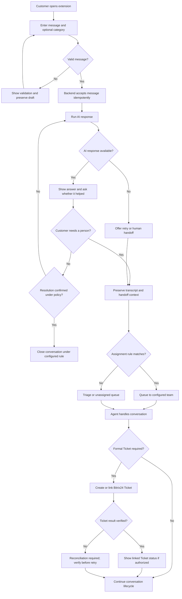

# Browser Extension — Screen Specifications and Processing Flows

- Version: 0.2 design proposal
- Updated: 2026-10-20
- Status: Proposed for review; illustrative UI, not an approved brand or policy.
- Scope: Customer-facing Browser Extension only.

## Visual mockup

The visual shows three states: welcome/new conversation, AI first response, and human handoff. Labels and times are illustrative.

## Screen inventory

| ID | Screen | User goal | Main actions | Important states |
|---|---|---|---|---|
| EXT-01 | Welcome / new conversation | Start a request with minimal friction | Select category, enter message, start | Initial, validation error, submitting, offline |
| EXT-02 | AI first response | Get an answer or add context | Send message, helpful/not helpful, request a person | AI processing, answered, unavailable, send failed |
| EXT-03 | Human handoff | Reach the right team without repeating context | Request person, add details, view status | Routing, waiting, assigned, triage, routing failed |
| EXT-04 | Live agent conversation | Continue with a human agent | Send/receive messages, see agent status | Connecting, connected, reconnecting, ended |
| EXT-05 | Request/Ticket status | Understand the formal request status | View status, open linked Ticket if authorized | No Ticket, pending creation, linked, reconciliation required |
| EXT-06 | Feedback | Rate support after resolution | Select rating, optional comment, submit | Not submitted, submitting, submitted, failed |

## EXT-01 — Welcome / new conversation

### Layout
- Header: product/support name, online/offline indicator, close/minimize control.
- Optional category shortcuts: Technical, Sales, Other. Categories are configurable.
- Message field and primary Start conversation action.
- Privacy notice/link only when the approved notice URL is configured.

### Behavior
1. User opens the extension; the client fetches a short-lived session or resumes an authorized conversation.
2. User may select a category and enter a message.
3. Validate message is not blank; trim whitespace but do not silently discard meaningful content.
4. Submit to the backend with an idempotency key.
5. Backend creates/resumes conversation and stores the message before invoking AI.
6. UI moves to EXT-02 only after the backend acknowledges acceptance.
7. If offline or the request fails, preserve the draft and show Retry; do not show a false success state.

### Acceptance criteria
- Empty input cannot be submitted.
- Double-tap/retry does not create duplicate messages.
- No secrets, API keys, internal prompts, or internal notes are sent to the extension.
- The client shows an explicit failure when the server has not accepted the message.

## EXT-02 — AI first response

### Behavior
1. Display the accepted customer message and a pending state.
2. Backend invokes the configured AI provider; provider credentials remain server-side.
3. AI output is checked against application policy before it is displayed.
4. Render answer and allow a follow-up, helpful/not helpful feedback, or request for a human.
5. If AI fails or times out, preserve conversation history and offer human handoff or retry according to configured policy.
6. Never claim the issue is resolved merely because the AI returned text. Resolution requires the approved business rule, such as customer confirmation.

### Acceptance criteria
- Processing state is visible and does not block the user indefinitely.
- A failed AI response does not delete the accepted customer message.
- Internal AI instructions, chain-of-thought, provider errors containing secrets, and staff-only notes are never exposed.
- Retry is bounded and does not duplicate the conversation or message.

## EXT-03 — Human handoff

### Behavior
1. User requests a human, or policy determines escalation is needed.
2. Backend records handoff reason and carries forward transcript, customer context, AI summary, and selected category.
3. Routing engine evaluates the approved assignment matrix.
4. If a valid rule matches, place the conversation in the configured team queue and apply assignment policy.
5. If no valid mapping or no eligible agent exists, use Triage/unassigned and show a truthful waiting state.
6. Notify the customer when status changes; never invent an ETA.
7. Create or link a Bitrix24 Ticket only when the configured business rule requires formal tracking.
8. If Ticket creation times out, mark reconciliation required and check for an existing Ticket before retrying.

### Acceptance criteria
- Transcript and context survive handoff.
- No random assignment when mapping is missing.
- Customer sees waiting, assigned, or failure state accurately.
- Ticket creation failure does not falsely report success.
- Internal notes remain staff-only.

## EXT-04 — Live agent conversation

- Show message delivery states: sending, sent/accepted, failed.
- Support reconnecting without losing draft or transcript.
- Clearly distinguish AI, agent, and system messages.
- Enforce server-side authorization for every conversation read/write.
- The extension must tolerate browser suspension; critical routing, AI, and Ticket jobs run server-side.

## EXT-05 — Request/Ticket status

- Conversation and Ticket are different entities: chat is the channel; Bitrix24 is the formal ticket record when required.
- Show Ticket identifier/link only after a verified link exists and the user is authorized to see it.
- While creation is pending, show pending; after timeout, show a neutral checking/reconciliation state.
- Do not expose internal assignment notes, private fields, or staff-only URLs.

## EXT-06 — Feedback

- Offer feedback only at an approved lifecycle point.
- Store rating/comment against the conversation and, if configured, the related Ticket.
- Validate input and prevent accidental duplicate submissions.
- Feedback must not change Ticket status unless an explicit rule is approved.

## End-to-end flow

## Decisions that remain open

- Approved brand/logo and category labels.
- Browser targets and extension manifest/version.
- Authentication/session model and privacy notice.
- Exact resolution/auto-close rule and escalation policy.
- Assignment matrix, queue behavior, SLA and response-time wording.
- Bitrix24 entity type, required fields, link visibility and creation rules.
- Attachment policy, retention period, supported languages and accessibility review.

These are configuration/product decisions, not assumptions to hard-code.
