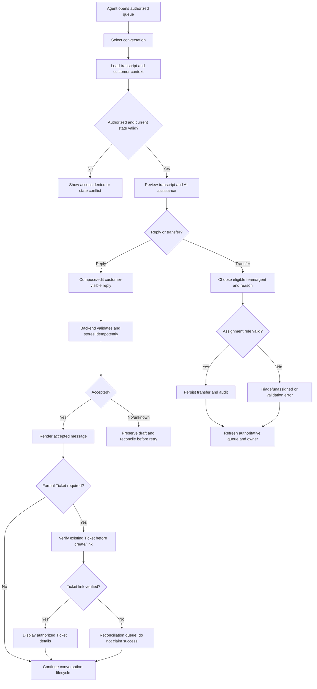

# Support Dashboard — Screen Specifications and Processing Flows

- Version: 0.2 design proposal
- Updated: 2026-10-20
- Status: Proposed for review; illustrative screens, not approved brand/policy.
- Scope: Support agents, team leads and authorized operations staff.

## Visual mockup

The mockup illustrates queue triage, agent conversation workspace, and customer/Ticket context. Example names, IDs, times and values are illustrative.

## Screen inventory

| ID | Screen | Primary users | Main purpose |
|---|---|---|---|
| SUP-01 | Conversation queue | Agent, lead | Find waiting, assigned, unassigned and attention-needed conversations |
| SUP-02 | Agent workspace | Agent | Read transcript, reply, use AI draft, add staff-only note |
| SUP-03 | Customer and Ticket context | Agent, lead | Review context, AI summary, assignment, SLA and verified Bitrix24 link |
| SUP-04 | Assignment / transfer dialog | Agent, lead | Transfer to a permitted queue/agent with reason and context |
| SUP-05 | Ticket reconciliation | Authorized agent, lead/admin | Investigate pending/timeout/unknown Ticket creation outcome |
| SUP-06 | Conversation resolution | Agent | Record outcome and close only under configured policy |

## SUP-01 — Conversation queue

### Layout and data
- Queue tabs: assigned to me, team queue, unassigned/triage, attention needed; visibility is permission-scoped.
- Search and filters: conversation ID, customer, team, state, channel, age and configured priority.
- Each row shows minimum necessary data: customer display name, latest message preview, waiting age, category, assignment and state.
- Never show private customer fields in the queue unless needed and authorized.

### Behavior
1. Fetch paginated queue from the server; apply filters server-side where possible.
2. Keep assignment and state fresh through the chosen realtime/polling mechanism.
3. Selecting a row opens SUP-02 and loads authorized context.
4. If a row is unassigned, show explicit triage/unassigned state. Do not imply that an agent owns it.
5. Lead views may include routing failures and Ticket reconciliation items; ordinary agents see only items authorized for them.

### Acceptance criteria
- Pagination and filters do not leak records across teams/tenants.
- Loading, empty, no-results, partial-data and request-failed states are defined.
- Duplicate events do not duplicate queue items.
- Queue counts are labeled as approximate if the backend cannot guarantee a transactionally consistent count.

## SUP-02 — Agent workspace

### Layout
- Header: conversation ID, customer, category, state, current owner and permitted actions.
- Main pane: transcript in chronological order with distinct customer, AI, agent and system event styling.
- Composer: message field, attachment control only if approved, send state, optional internal-note mode.
- AI assist: intent/summary/suggested reply with clear advisory label and insert/edit controls.
- Staff-only notes are visibly separated from customer-visible messages.

### Reply behavior
1. Validate non-empty message.
2. Submit with idempotency key; show sending state.
3. Backend authorizes actor, checks conversation state, persists message and returns acceptance.
4. Show accepted/sent state only from backend acknowledgement; on uncertain timeout, reconcile by idempotency key before retry.
5. Preserve draft on failure and let the agent retry safely.
6. Internal notes use a separate server-side message type and can never be returned by customer transcript APIs.

### AI assistance
- AI may summarize, classify intent and suggest wording.
- The agent reviews/edits the draft and explicitly sends it.
- AI suggestion never directly changes assignment, Ticket state or SLA.
- If AI is unavailable, ordinary manual handling remains available.

### Acceptance criteria
- A failed send never appears as confirmed sent.
- Internal notes cannot be read through customer-facing APIs.
- Transcript order is stable and handles reconnects without duplicate rendering.
- Permission changes and closed/locked states are enforced server-side.

## SUP-03 — Customer and Ticket context

### Sections
- Customer profile: only authorized fields.
- Conversation metadata: ID, channel, category, created time, current state.
- AI summary and suggested intent: labeled advisory until accepted.
- Assignment and SLA: based on actual configured policy.
- Bitrix24 Ticket panel: no Ticket, pending, linked/verified, failed or reconciliation required.

### Ticket rules
- Conversation and Ticket are distinct records.
- Show Ticket ID and deep link only after backend verifies the relation and the actor has permission.
- On create timeout, mark outcome unknown/reconciliation required; search/verify before any retry.
- A failed or uncertain integration must not be shown as success.
- Exact Bitrix24 entity type and fields remain configuration/product decisions until confirmed.

## SUP-04 — Assignment / transfer dialog

1. User opens transfer action.
2. Server returns only eligible teams/agents for that actor and conversation.
3. User selects target and reason; optionally confirms the summary/context to transfer.
4. Server validates permission, assignment rules and current state.
5. Transfer is persisted atomically or returned as a conflict; UI refreshes the authoritative owner.
6. If no valid mapping exists, send to configured Triage/unassigned queue rather than choosing randomly.
7. Audit actor, old owner, new owner, reason and timestamp.

## SUP-05 — Ticket reconciliation

- Restrict access to authorized roles.
- Show conversation ID, last integration attempt, safe error category, correlation/idempotency key and current verification state.
- Offer “Check status” first. Retry creation only after confirming no existing Ticket is linked/created and policy permits retry.
- Never display integration secrets or raw error payloads containing sensitive data.
- Audit every manual reconcile/retry action.

## SUP-06 — Conversation resolution

- Show resolution reason/outcome using configured values.
- Verify required fields and any required customer confirmation.
- Closing a conversation does not automatically close a Bitrix24 Ticket unless an explicit mapping is configured.
- Reopen behavior, auto-close delay and SLA stop conditions remain unapproved decisions until product owner confirms them.

## End-to-end agent flow

## Required UI states

- Queue: loading, empty, no results, partial data, access denied, fetch failed.
- Conversation: loading, sending, accepted, send failed, uncertain outcome, reconnecting, locked/closed, permission revoked.
- AI assist: loading, ready, unavailable, policy-filtered, stale suggestion.
- Ticket: none required, pending, linked, create failed, outcome unknown/reconciliation required.
- Assignment: current owner, unassigned, transfer pending, transfer accepted, conflict, no eligible target.

## Open decisions

- Identity provider, role matrix and exact team/tenant data boundaries.
- Realtime transport and queue refresh frequency.
- Assignment matrix and transfer permissions.
- SLA start/pause/stop rules and priority values.
- Bitrix24 entity type, fields, deep-link pattern and retry policy.
- Attachment policy, retention and audit retention.
- Resolution reasons, reopen rules and customer confirmation policy.

Do not hard-code these until approved.
