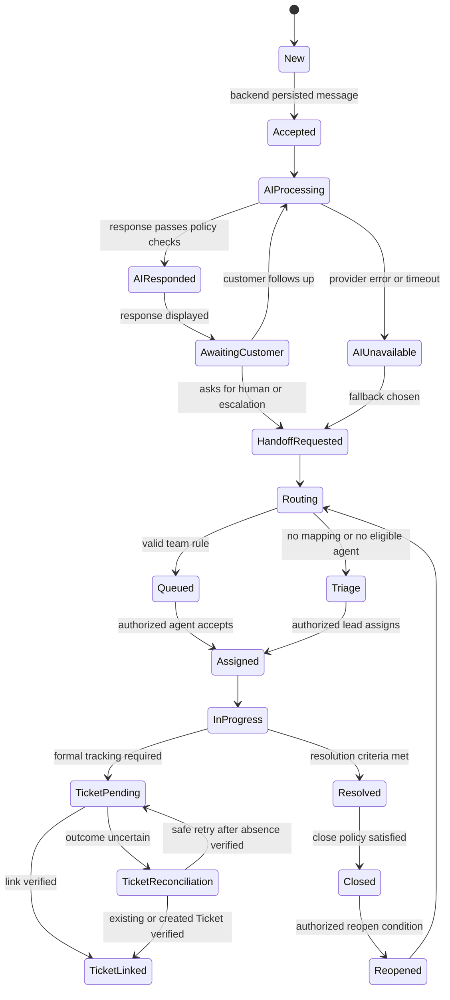
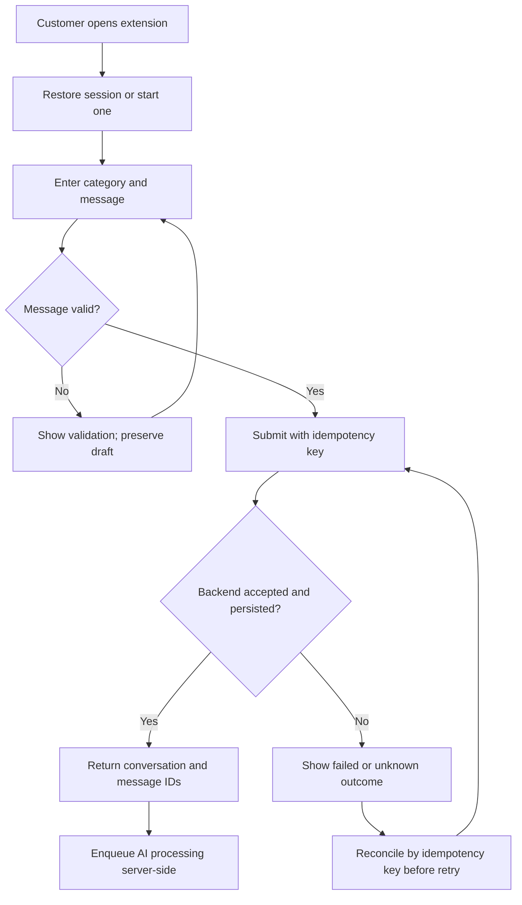
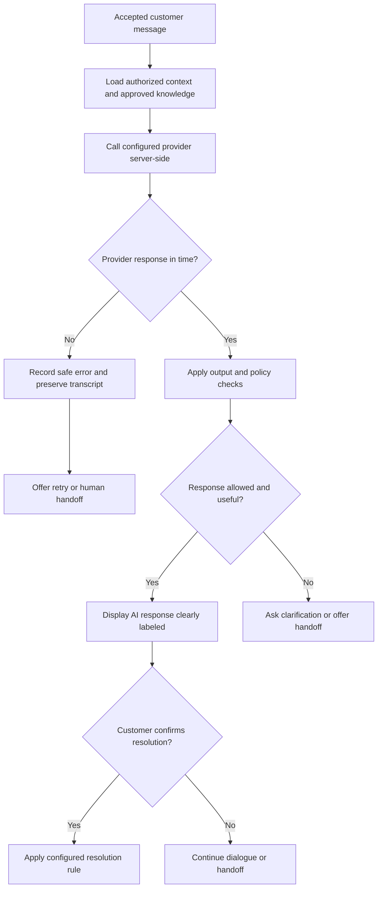
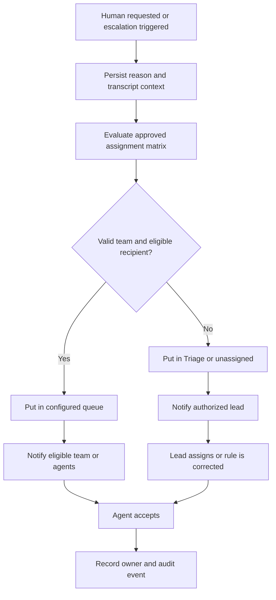
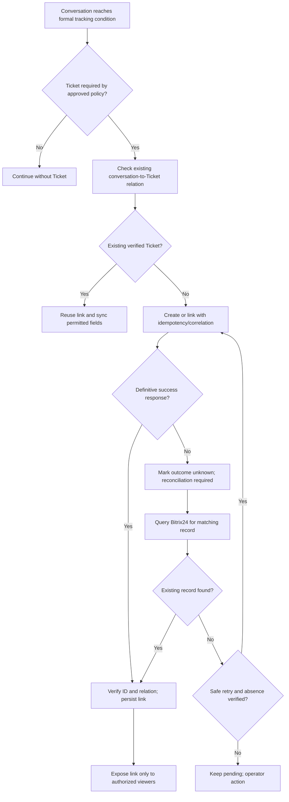
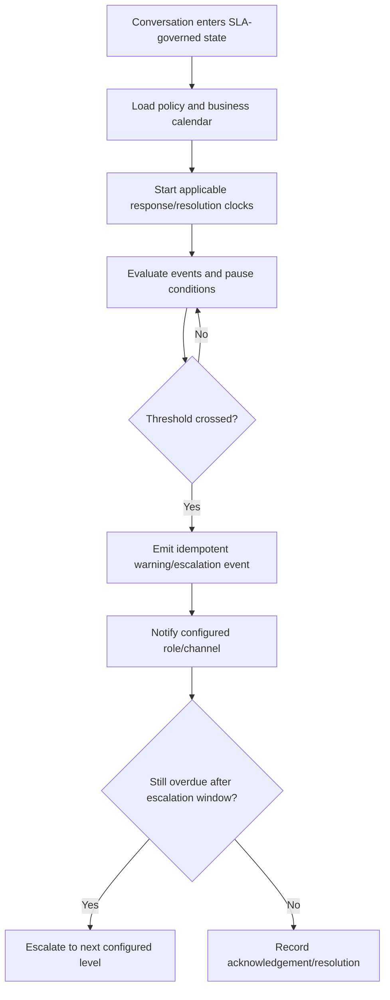
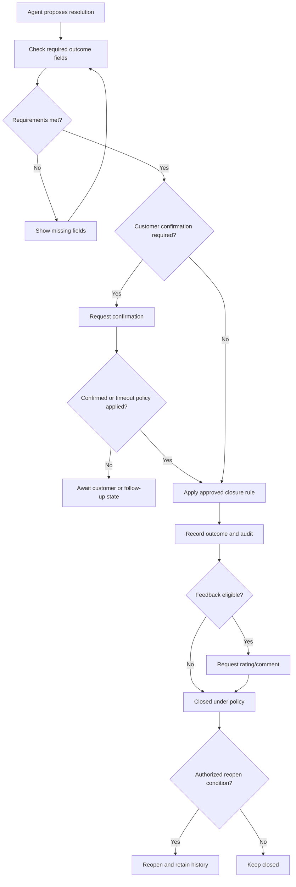
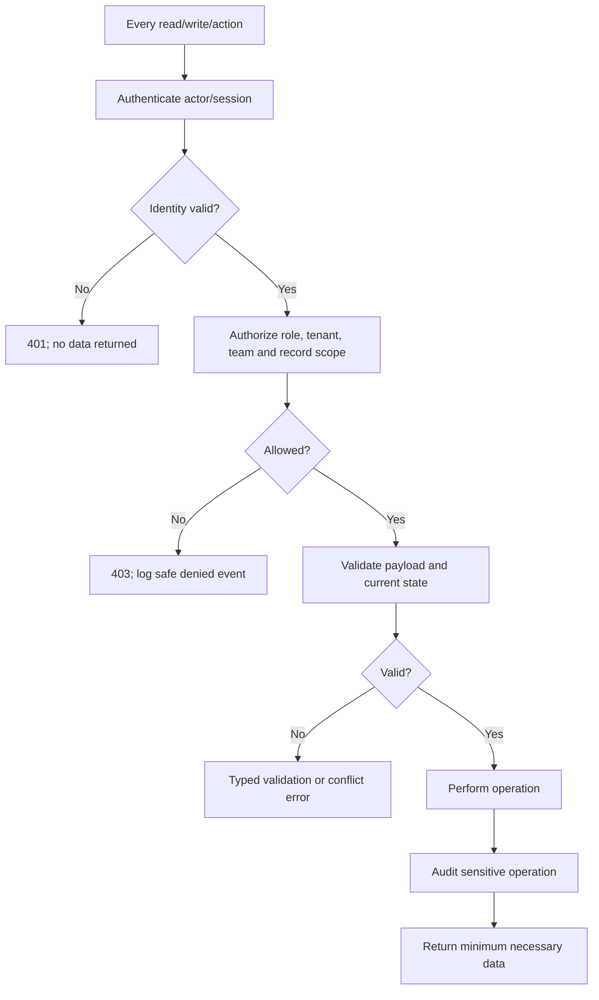
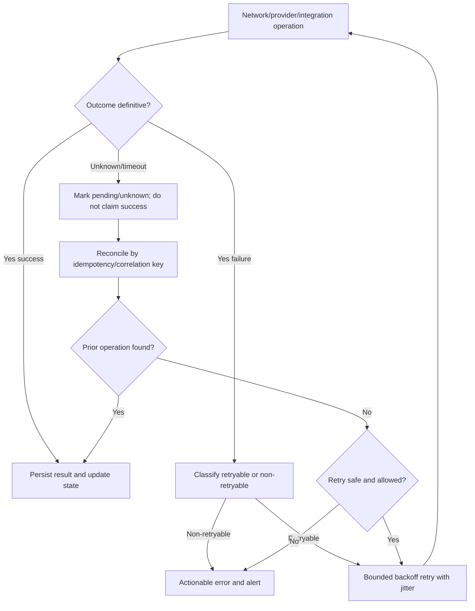

# Flow Support Chat — Complete Support Flows and UI Package

- Version: 1.0 candidate baseline
- Updated: 2026-10-20
- Status: Comprehensive draft for Product Owner/Technical review. Production policy still requires approval.
- Scope: Extension, AI response, handoff, Dashboard, Bitrix24, SLA, closure, security, recovery and Admin Portal.

## Visual interface package

### Customer Browser Extension

[Detailed Extension specification](10-browser-extension-screen-specifications.md)

### Support Dashboard

[Detailed Support Dashboard specification](11-support-dashboard-screen-specifications.md)

### Admin Portal

[Admin Portal screen specification](13-admin-portal-screen-specifications.md)

All are vector concept mockups. Sample names, IDs, statuses and metrics are illustrative.

## 1. Master lifecycle

## 2. F01 — Intake and persistence

Invariant: persist the user message before invoking AI. Do not confirm acceptance before backend acknowledgement. A duplicate idempotency key returns the same logical message.

## 3. F02 — AI First Response

AI must not independently assign staff, claim a Ticket exists, or close a request outside approved policy.

## 4. F03 — Handoff and assignment

Transfer context includes transcript, customer-visible history, AI summary marked as AI-generated, category suggestion, reason and correlation ID. Staff-only notes never enter customer transcript. Assignment is server-authoritative and audited.

## 5. F04 — Bitrix24 Ticket create/link/update

Timeout is not proof of failure. Never blindly retry creation after an unknown outcome. The Bitrix24 entity type, fields, deep link and status map must be confirmed before production.

## 6. F05 — SLA and escalation

Policy must define timezone, holidays, first-response and resolution clocks, pause/resume conditions, ownership changes, escalation tiers and stop conditions. Do not invent numeric SLA values.

## 7. F06 — Resolution, closure, feedback and reopen

Conversation closure and Bitrix24 Ticket closure are separate unless an approved mapping explicitly links them. Feedback does not change Ticket status by itself.

## 8. F07 — Security, authorization and audit

Server-side authorization is mandatory. Customer-visible messages and staff-only notes require distinct permissions. Secrets remain server-side and must not be logged. Audit events should capture actor, action, target, timestamp, outcome and correlation ID without unnecessary sensitive payloads.

## 9. F08 — Failure, retry, recovery and reconciliation

AI, routing, Ticket creation, SLA jobs and reconciliation must run in durable server-side jobs, not depend on the extension remaining awake. Retries are bounded and idempotent; define dead-letter/alerting and operator recovery.

## 10. Cross-flow state models

Conversation: NEW → ACCEPTED → AI_PROCESSING → AI_RESPONDED → AWAITING_CUSTOMER → HANDOFF_REQUESTED → ROUTING → QUEUED/TRIAGE → ASSIGNED → IN_PROGRESS → RESOLVED → CLOSED. Exceptions include AI_UNAVAILABLE, TICKET_PENDING, TICKET_LINKED and TICKET_RECONCILIATION. Reopen only when policy permits.

Ticket linkage: NOT_REQUIRED/NOT_CREATED → PENDING → LINKED_VERIFIED, or PENDING → OUTCOME_UNKNOWN/RECONCILIATION_REQUIRED → LINKED_VERIFIED / SAFE_RETRY_PENDING / OPERATOR_ACTION_REQUIRED. Do not combine conversation and Ticket status in one field.

Message delivery: DRAFT → SENDING → ACCEPTED, or SENDING → FAILED/OUTCOME_UNKNOWN; reconcile uncertain outcomes by idempotency key before retry.

Assignment: UNASSIGNED/TRIAGE → QUEUED → ASSIGNED → TRANSFER_PENDING → ASSIGNED. A conflict preserves authoritative ownership and returns a visible error.

## 11. Screen-to-flow map

| Surface | Screen | Flows |
|---|---|---|
| Extension | Welcome/new conversation | F01 |
| Extension | AI response | F02 |
| Extension | Human handoff | F03, F08 |
| Extension | Live conversation | F01, F03, F08 |
| Extension | Ticket status | F04 |
| Extension | Feedback/resolution | F06 |
| Dashboard | Queue | F03, F05, F08 |
| Dashboard | Agent workspace | F02, F03, F06, F08 |
| Dashboard | Customer/Ticket context | F04 |
| Dashboard | Reconciliation | F04, F08 |
| Admin | Assignment matrix | F03 |
| Admin | SLA policy | F05 |
| Admin | AI/Bitrix24 settings | F02, F04, F08 |
| Admin | Audit and operations | F07, F08 |

## 12. Acceptance and release gates

- [ ] Each screen has role scope, actions, states, API mapping and error behavior.
- [ ] Each flow covers success, negative path, timeout/unknown outcome and recovery.
- [ ] Message send and Ticket create/link are idempotent or reconciled before retry.
- [ ] Customer transcript and staff-only notes are isolated.
- [ ] Routing has a Triage fallback and no random assignment.
- [ ] SLA clocks and escalation thresholds are configuration-driven.
- [ ] Conversation and Ticket lifecycle are distinct and mapped explicitly.
- [ ] Audit covers assignment, sensitive config, Ticket reconciliation and permission changes.
- [ ] Extension suspension does not interrupt critical backend work.
- [ ] API/DB enum and event contracts are reconciled with docs 02, 03, 05 and 06.
- [ ] Security, accessibility, retention, monitoring and recovery tests pass.
- [ ] Product Owner signs off all OPEN decisions before production.

## 13. Decisions blocking production sign-off

1. Bitrix24 entity type, required fields, deduplication key, status map and Ticket visibility.
2. Assignment matrix, eligibility, working hours and no-agent fallback.
3. SLA calendar/timezone, thresholds, pause/resume and escalation tiers.
4. Resolution confirmation, auto-close, reopen window and feedback policy.
5. Identity/SSO, role matrix, tenant boundaries and customer authentication.
6. Attachment limits, malware scanning, retention and privacy notice.
7. Realtime transport, retry budgets, queue technology and alert channels.
8. Supported browsers/extension manifest, languages and accessibility target.
9. Approved brand, labels and production categories.

This is a comprehensive candidate baseline for review, not proof that production policy has been approved.
