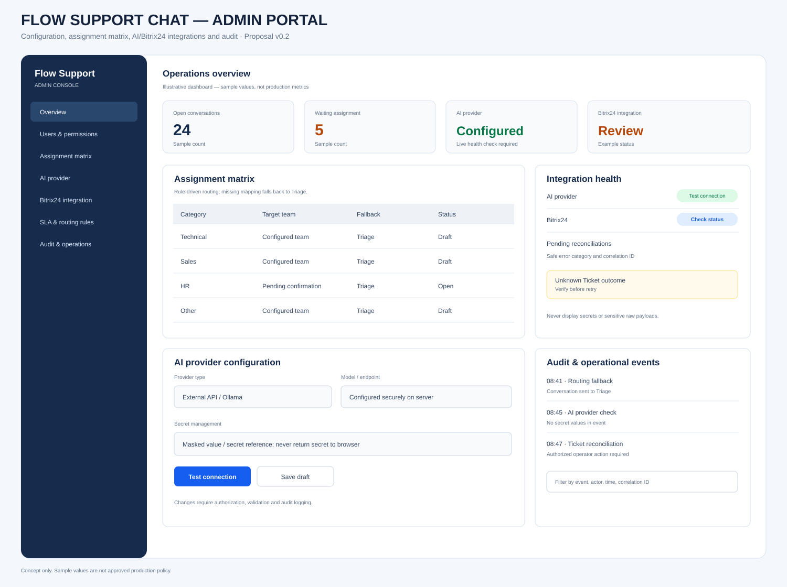
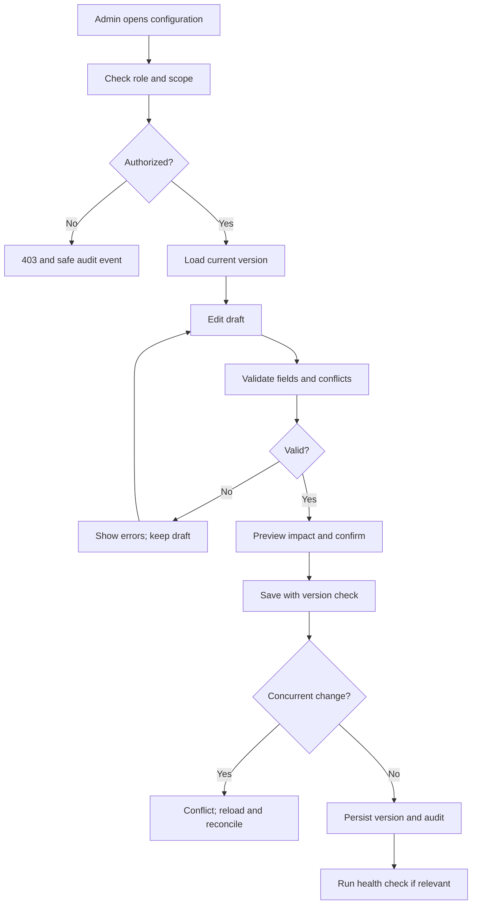

# Admin Portal — Screen Specifications and Processing Flows

- Version: 0.2 proposal
- Scope: authorized administrators and operations leads.
- Settings require role-based authorization, validation and audit logging.

## Visual mockup

## Screens

| ID | Screen | Responsibilities |
|---|---|---|
| ADM-01 | Operations overview | Queue counts, integration health and reconciliation workload |
| ADM-02 | Users and permissions | Manage roles and team membership within authorized scope |
| ADM-03 | Assignment matrix | Map categories/intent to eligible teams and safe Triage fallback |
| ADM-04 | AI provider | Configure API/Ollama endpoint and server-side secret reference |
| ADM-05 | Bitrix24 integration | Connection test, entity/field/status mapping and sync policy |
| ADM-06 | SLA and routing rules | Configure calendars, thresholds, pause/resume and escalation tiers |
| ADM-07 | Audit and reconciliation | Search safe audit events and inspect uncertain integration outcomes |

## Configuration change flow

## Security and operations

- Provider secrets live in server-side secret management; show masked values/references only.
- Never expose credentials, tokens or raw sensitive provider errors to browser/logs.
- Assignment changes are versioned and audited; invalid mapping routes to Triage.
- Bitrix24 entity type and fields must be confirmed against target tenant.
- Saves are validated, authorized and protected against concurrent overwrite.
- Destructive changes require confirmation and preserve audit history.
- Reconciliation verifies existing Ticket before permitting retry.
