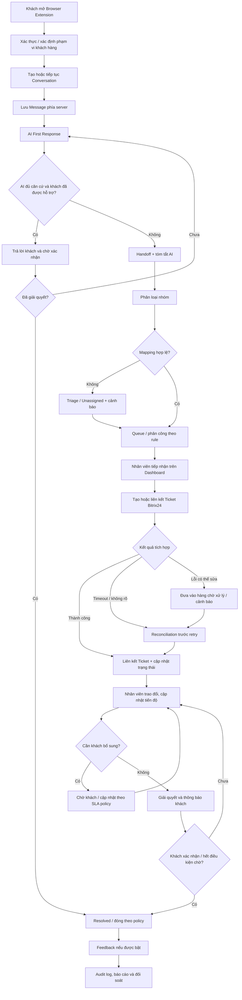

# Flow Support Chat — Sổ tay vận hành tổng thể

- **Mã tài liệu:** FSC-OPS-MASTER
- **Phiên bản:** 1.0
- **Ngày tổng hợp:** 2026-10-20
- **Trạng thái:** Master guide — tổng hợp và điều hướng tài liệu; các chính sách còn OPEN vẫn cần PO/Tech Lead phê duyệt.
- **Mục tiêu:** Dùng một đường dẫn duy nhất để hiểu toàn bộ luồng vận hành, mở đúng flow, yêu cầu, bảng quyết định, giao diện, hình ảnh, API và test.
- **Phạm vi:** Flow Support Chat — Browser Extension khách hàng, AI First Response, chuyển nhân viên hỗ trợ, Support Dashboard, Admin Portal và tích hợp Ticket Bitrix24.
- **Lưu ý quan trọng:** Tài liệu này là trang điều hướng tổng thể, không thay thế các tài liệu chi tiết được liên kết. Không coi nội dung PROPOSED/OPEN là chính sách production đã được duyệt.

---

## 1. Bản đồ toàn bộ hệ thống

**Hệ thống gồm ba bề mặt sử dụng chính:**
1. **Customer Browser Extension:** Khách mở chat, gửi yêu cầu, nhận phản hồi AI, chuyển người thật, theo dõi tiến độ và phản hồi kết quả.
2. **Support Dashboard:** Nhân viên tiếp nhận hàng chờ, đọc lịch sử và tóm tắt AI, trả lời khách, cập nhật tiến độ, chuyển giao và giải quyết hội thoại.
3. **Admin Portal:** Người được cấp quyền quản lý mapping nhóm/nhân sự, cấu hình định tuyến, theo dõi lỗi tích hợp và kiểm toán thay đổi.

Backend là nơi kiểm soát trạng thái, quyền, lưu trữ, routing, assignment, job retry và liên kết Ticket. Browser Extension không được giữ bí mật dài hạn hoặc tự quyết định quyền truy cập. Bitrix24 là hệ thống Ticket tích hợp; loại đối tượng và field mapping thực tế phải được xác minh trước production.

## 2. Luồng vận hành end-to-end

**Nguyên tắc xuyên suốt**
- Message chỉ được xác nhận đã gửi khi server đã lưu thành công.
- Retry không được tạo trùng Message, Ticket hoặc notification.
- Trạng thái Conversation, Ticket và trạng thái đồng bộ là các khái niệm riêng.
- Nếu AI không chắc chắn, khách yêu cầu người thật hoặc điều kiện handoff bắt buộc xảy ra, chuyển sang người thật theo policy đã duyệt.
- Không có mapping hợp lệ thì chuyển Triage/Unassigned và cảnh báo; không gán ngẫu nhiên.
- Khi kết quả tạo Ticket không rõ do timeout, đối soát trước khi thử tạo lại.
- Quyền truy cập được kiểm tra ở server cho mọi dữ liệu riêng tư.
- Ghi chú nội bộ không được gửi ra kênh khách hàng.

## 3. Danh mục luồng vận hành chi tiết

### F01 — Tiếp nhận và lưu hội thoại
**Mục tiêu:** Không mất dữ liệu, đúng danh tính và đúng phạm vi truy cập.

1. Khách mở Extension.
2. Hệ thống xác thực hoặc áp dụng đúng luồng công khai được phép.
3. Xác định tiếp tục Conversation cũ hay tạo Conversation mới theo policy.
4. Server tạo định danh Conversation và lưu Message.
5. UI hiển thị trạng thái gửi; lỗi mạng cho phép retry an toàn.
6. Khi Extension đóng/mở lại, tải lịch sử theo quyền.

**Ngoại lệ:** Chưa xác thực, session hết hạn, gửi trùng, mất mạng, dữ liệu không hợp lệ, khách truy cập sai tenant.

**Tài liệu chi tiết:** [01 — Business Workflow](01-business-workflow-specification.md) · [02 — Functional Requirements](02-functional-requirements.md) · [06 — API & Data Contract](06-api-and-data-contract-draft.md) · [10 — Extension Screens](10-browser-extension-screen-specifications.md)

### F02 — AI First Response
**Mục tiêu:** Trả lời bước đầu có căn cứ, không bịa thông tin và không giữ khách trong vòng lặp vô hạn.

1. AI nhận nội dung cùng ngữ cảnh được phép.
2. Phân loại ý định và nhận diện thông tin còn thiếu.
3. Tra cứu kho tri thức được phê duyệt khi cần.
4. Trả lời hoặc hỏi bổ sung.
5. Nếu không có căn cứ, lỗi/timeout, khách yêu cầu người thật hoặc điều kiện bắt buộc handoff xảy ra, chuyển sang F03.
6. Ghi nhận thông tin/tóm tắt có ích cho nhân viên.

**Ngoại lệ:** Provider lỗi, confidence thấp, nội dung nhạy cảm, quá số vòng hỏi, tri thức lỗi thời hoặc khách không phản hồi. Ngưỡng và số vòng phải do PO phê duyệt.

**Tài liệu chi tiết:** [01](01-business-workflow-specification.md) · [02](02-functional-requirements.md) · [03 — Decision Tables](03-decision-tables-and-state-transitions.md) · [12 — Complete Support Flows](12-complete-support-flows.md)

### F03 — Handoff và phân loại
**Mục tiêu:** Chuyển nguyên ngữ cảnh từ AI sang đúng nhóm/người có trách nhiệm.

1. Kích hoạt handoff theo policy.
2. Tạo handoff record và tóm tắt nội bộ.
3. Phân loại Technical, Sales, HR, Other hoặc Triage.
4. Nếu phân loại mơ hồ/xung đột, đưa vào Triage.
5. Áp dụng ma trận mapping đã duyệt.
6. Giữ nguyên Conversation ID và lịch sử khi chuyển nhóm.
7. Ghi nhận lý do, người thao tác và thời điểm.

**Ngoại lệ:** Không có mapping, nhân sự không hoạt động, agent từ chối/không nhận, queue quá tải, chuyển nhóm nhiều lần. Không random assignment.

**Tài liệu chi tiết:** [03 — Decision Tables](03-decision-tables-and-state-transitions.md) · [05 — Implementation Blueprint](05-implementation-blueprint.md) · [11 — Support Dashboard](11-support-dashboard-screen-specifications.md) · [14 — Decision Register](14-business-questions-and-decision-register.md)

### F04 — Nhân viên tiếp nhận và xử lý
**Mục tiêu:** Nhân viên nhìn thấy đúng queue, lịch sử, ngữ cảnh và trách nhiệm hiện tại.

1. Nhân viên đăng nhập Dashboard.
2. Xem queue theo quyền và bộ lọc được cấp.
3. Mở Conversation, đọc lịch sử và tóm tắt AI.
4. Xác nhận nhận việc theo quy trình.
5. Trả lời khách hoặc thêm internal note.
6. Cập nhật tiến độ, yêu cầu thêm thông tin, chuyển nhóm/người nếu cần.
7. Ghi lý do và audit cho thao tác quan trọng.

**Ngoại lệ:** Agent mất quyền/đăng xuất, nhiều người cùng nhận, khách gửi đồng thời lúc resolve, chuyển giao không có người nhận.

**Tài liệu chi tiết:** [08 — Screen Inventory](08-screen-inventory-and-user-flows.md) · [11 — Support Dashboard](11-support-dashboard-screen-specifications.md) · [13 — Admin Portal](13-admin-portal-screen-specifications.md)

### F05 — Tạo, liên kết và đồng bộ Ticket Bitrix24
**Mục tiêu:** Conversation có liên kết Ticket bền vững, tránh tạo trùng và có thể khôi phục sau lỗi.

1. Kiểm tra Conversation đã có Ticket link chưa.
2. Xác định đối tượng Bitrix24, field bắt buộc và mapping đã được xác minh.
3. Gửi yêu cầu tạo/liên kết qua backend.
4. Chỉ báo thành công khi có xác nhận đáng tin cậy.
5. Lưu external ID, link, trạng thái đồng bộ và correlation data.
6. Nếu timeout/response không rõ, đối soát trước khi retry.
7. Nếu lỗi validation/quyền, tạo tác vụ xử lý và cảnh báo; không retry vô hạn.
8. Đồng bộ trạng thái theo mapping đã duyệt.

**Điểm chặn production:** Chưa giả định Ticket là Task, CRM hay Smart Process. Phải xác minh tenant, entity type, field/status, API permission, deduplication key và quyền truy cập thực tế.

**Tài liệu chi tiết:** [01](01-business-workflow-specification.md) · [03](03-decision-tables-and-state-transitions.md) · [05](05-implementation-blueprint.md) · [06](06-api-and-data-contract-draft.md) · [11](11-support-dashboard-screen-specifications.md)

### F06 — SLA, ưu tiên và escalation
**Mục tiêu:** Tính và cảnh báo SLA nhất quán với policy.

1. Xác định loại SLA: phản hồi đầu tiên, cập nhật tiếp theo hoặc giải quyết.
2. Áp dụng ưu tiên và lịch làm việc đã duyệt.
3. Xác định điều kiện pause/resume khi chờ khách/bên thứ ba.
4. Gửi cảnh báo ở các mốc cấu hình.
5. Escalate theo cấp và ghi lại event.
6. Báo cáo phân biệt breach thực tế và lỗi đồng bộ.

**Chưa được tự giả định:** timezone, ngày nghỉ, giờ làm việc, mốc cảnh báo, pause/resume, reset khi chuyển nhóm và ngưỡng escalation.

**Tài liệu chi tiết:** [01](01-business-workflow-specification.md) · [02](02-functional-requirements.md) · [03](03-decision-tables-and-state-transitions.md) · [14](14-business-questions-and-decision-register.md)

### F07 — Giải quyết, đóng, mở lại và feedback
**Mục tiêu:** Không đóng nhầm yêu cầu chưa được giải quyết và có lịch sử kết quả.

1. Nhân viên cập nhật kết quả xử lý.
2. Hệ thống chuyển sang trạng thái Resolved theo điều kiện được duyệt.
3. Thông báo khách và yêu cầu xác nhận nếu policy yêu cầu.
4. Đóng theo quy tắc xác nhận/timeout đã duyệt.
5. Cho phép mở lại trong điều kiện được duyệt; giữ lịch sử.
6. Gửi feedback nếu tính năng được bật.
7. Đồng bộ trạng thái Ticket và Conversation theo mapping, không gộp hai state machine.

**Tài liệu chi tiết:** [01](01-business-workflow-specification.md) · [03](03-decision-tables-and-state-transitions.md) · [04 — Acceptance Tests](04-acceptance-test-scenarios.md) · [10](10-browser-extension-screen-specifications.md) · [11](11-support-dashboard-screen-specifications.md)

### F08 — Bảo mật, quyền và audit
**Mục tiêu:** Chỉ người có quyền mới xem hoặc thao tác dữ liệu được phép.

- Xác thực và kiểm tra session.
- Phân quyền theo vai trò, khách hàng/tenant, nhóm và tài nguyên.
- Bảo vệ API kể cả khi gọi trực tiếp, không chỉ ẩn nút trên UI.
- Tách internal note khỏi public message.
- Giữ secret ở server/secret store.
- Ghi audit cho thay đổi mapping, quyền, assignment và trạng thái quan trọng.
- Có chính sách file/retention/privacy được duyệt trước production.

**Tài liệu chi tiết:** [02](02-functional-requirements.md) · [05](05-implementation-blueprint.md) · [09 — UI/UX Checklist](09-ui-ux-implementation-checklist.md) · [12](12-complete-support-flows.md)

### F09 — Retry, recovery và reconciliation
**Mục tiêu:** Khôi phục an toàn sau lỗi mà không tạo dữ liệu trùng.

- Retry có giới hạn và backoff theo thiết kế kỹ thuật được duyệt.
- Các thao tác có side effect dùng idempotency/deduplication.
- Job quan trọng chạy phía server, không phụ thuộc browser còn mở.
- Lưu trạng thái job và lỗi có thể vận hành điều tra.
- Reconcile Ticket khi kết quả tạo không rõ.
- Có alert và quy trình xử lý backlog.
- Kiểm tra worker restart, webhook lặp/sai thứ tự và khôi phục dữ liệu.

**Tài liệu chi tiết:** [03](03-decision-tables-and-state-transitions.md) · [05](05-implementation-blueprint.md) · [06](06-api-and-data-contract-draft.md) · [12](12-complete-support-flows.md) · [15 — Business Completeness Audit](15-business-completeness-audit.md)

## 4. State model — phân biệt các trạng thái

Không dùng một trường status duy nhất để đại diện tất cả.

| Đối tượng | Ý nghĩa | Ví dụ/ghi chú |
|---|---|---|
| Conversation | Vòng đời hội thoại | Open/AI handling/Waiting for agent/In progress/Waiting for customer/Resolved/Closed — cần đồng bộ với state model được duyệt |
| Assignment/Handoff | Trách nhiệm tiếp nhận | Pending/Queued/Assigned/Accepted/Transferred/Unassigned — tên chính thức cần chốt |
| Ticket | Trạng thái công việc trong Bitrix24 | Phụ thuộc đối tượng và trạng thái thực tế đã xác minh |
| Integration sync | Tình trạng đồng bộ ngoài | Pending/Synced/Retrying/Reconciliation required/Failed — cần chốt enum trong contract |
| Message | Tình trạng gửi | Sending/Sent/Failed; retry không được nhân đôi |
| SLA | Đồng hồ và cảnh báo | Running/Paused/Breached/Completed theo policy |

Bảng trên là mô hình khái niệm. Tên trạng thái production phải lấy từ tài liệu 03 đã được PO/Tech Lead duyệt.

## 5. Bản đồ màn hình và hình ảnh

### Customer Browser Extension

- [10 — Đặc tả màn hình Browser Extension](10-browser-extension-screen-specifications.md)
- [08 — Screen Inventory & User Flows](08-screen-inventory-and-user-flows.md)
- [Hình SVG Extension](assets/flow-support-extension-screens.svg)

### Support Dashboard

- [11 — Đặc tả Support Dashboard](11-support-dashboard-screen-specifications.md)
- [08 — Screen Inventory & User Flows](08-screen-inventory-and-user-flows.md)
- [Hình SVG Dashboard](assets/flow-support-dashboard-screens.svg)

### Admin Portal

- [13 — Đặc tả Admin Portal](13-admin-portal-screen-specifications.md)
- [Hình SVG Admin Portal](assets/flow-support-admin-screens.svg)

**Lưu ý:** SVG và giao diện trong docs/07–13 là concept/proposal, không phải UI production đã được duyệt. Dữ liệu, tên người, ID và thời gian trong mockup chỉ mang tính minh họa.

## 6. Danh mục tài liệu nguồn — mở trực tiếp

### Nghiệp vụ và quy tắc
1. [01 — Business Workflow Specification](01-business-workflow-specification.md)
2. [02 — Functional Requirements](02-functional-requirements.md)
3. [03 — Decision Tables and State Transitions](03-decision-tables-and-state-transitions.md)
4. [12 — Complete Support Flows](12-complete-support-flows.md)
5. [14 — Business Questions and Decision Register](14-business-questions-and-decision-register.md)

### QA, triển khai và API
6. [04 — Acceptance Test Scenarios](04-acceptance-test-scenarios.md)
7. [05 — Implementation Blueprint](05-implementation-blueprint.md)
8. [06 — API and Data Contract Draft](06-api-and-data-contract-draft.md)
9. [16 — Requirement Traceability Matrix](16-requirement-traceability-matrix.md)
10. [15 — Business Completeness Audit](15-business-completeness-audit.md)

### UI/UX và màn hình
11. [07 — UI Design System](07-ui-design-system.md)
12. [08 — Screen Inventory and User Flows](08-screen-inventory-and-user-flows.md)
13. [09 — UI/UX Implementation Checklist](09-ui-ux-implementation-checklist.md)
14. [10 — Browser Extension Screen Specifications](10-browser-extension-screen-specifications.md)
15. [11 — Support Dashboard Screen Specifications](11-support-dashboard-screen-specifications.md)
16. [13 — Admin Portal Screen Specifications](13-admin-portal-screen-specifications.md)

### Hình ảnh SVG
- [UI overview](assets/flow-support-ui-overview.svg)
- [Extension screens](assets/flow-support-extension-screens.svg)
- [Dashboard screens](assets/flow-support-dashboard-screens.svg)
- [Admin screens](assets/flow-support-admin-screens.svg)

## 7. Bộ test nghiệm thu hiện có

Tài liệu 04 hiện có 26 test case baseline:
- TC-001 đến TC-006: xác thực, AI hỏi bổ sung, trả lời có căn cứ, handoff và AI không có căn cứ.
- TC-007 đến TC-012: routing, phân loại mơ hồ, Primary không khả dụng và thiếu mapping.
- TC-013 đến TC-018: tạo Ticket, timeout, lỗi Bitrix24, Ticket tồn tại, nhiều yêu cầu và chuyển nhóm.
- TC-019 đến TC-026: chờ khách, chưa giải quyết, SLA, Extension đóng, truy cập chéo, internal note, retry notification và thay đổi assignment matrix.

[Đi đến toàn bộ kịch bản test](04-acceptance-test-scenarios.md)

Các test mới về concurrency, webhook lặp/sai thứ tự, worker restart, session hết hạn giữa thao tác và reconciliation sâu cần được bổ sung và chạy; chưa được coi là đã nghiệm thu.

## 8. Các quyết định cần chốt trước production

Nguồn chính thức để quản lý quyết định: [14 — Business Questions and Decision Register](14-business-questions-and-decision-register.md).

Các nhóm trọng yếu:
1. Danh tính khách hàng, tenant và quy tắc tạo/tiếp tục Conversation.
2. Nhân viên trả lời khách từ Dashboard hay Bitrix24; đâu là kênh làm việc chính.
3. Đối tượng Ticket Bitrix24, field/status mapping, deduplication và quyền API.
4. Ma trận Technical/Sales/HR/Other, Primary/Backup/Triage, availability và capacity.
5. AI provider, confidence, số vòng hỏi, fallback và điều kiện handoff.
6. SLA, giờ làm việc, ngày nghỉ, pause/resume và escalation.
7. Resolve/close/reopen, khách xác nhận và feedback.
8. Role matrix, auth/SSO, tenant isolation, file policy và retention.
9. Realtime transport, queue/retry, monitoring và alert.
10. Browser target, accessibility, ngôn ngữ và brand/labels.

Mọi quyết định phải có trạng thái, người duyệt, ngày duyệt và các tài liệu bị ảnh hưởng. Không tự hard-code giá trị còn OPEN.

## 9. Definition of Ready cho Dev

Một flow chỉ sẵn sàng triển khai khi:
- [ ] Mục tiêu, actor, trigger, precondition và postcondition rõ ràng.
- [ ] Happy path và các nhánh lỗi chính được mô tả.
- [ ] State transition và owner trách nhiệm rõ ràng.
- [ ] Quyết định nghiệp vụ cần thiết đã APPROVED hoặc được loại khỏi MVP có phê duyệt.
- [ ] Requirement ID có tiêu chí chấp nhận kiểm thử được.
- [ ] API/data contract và quyền được xác định.
- [ ] Screen states và thông báo lỗi tương ứng được mô tả.
- [ ] Test case và dữ liệu test được xác định.
- [ ] Phụ thuộc ngoài hệ thống, đặc biệt Bitrix24, được xác minh.

## 10. Definition of Done cho QA/Release

- [ ] Mọi requirement MUST trong phạm vi release có test và kết quả.
- [ ] Test ghi môi trường, build/version, PASS/FAIL, bằng chứng và defect ID.
- [ ] Không còn blocker hoặc critical defect chưa được xử lý.
- [ ] Permission/tenant isolation/internal note đã được kiểm thử ở server/API.
- [ ] Retry/idempotency/reconciliation đã được kiểm thử.
- [ ] Bitrix24 mapping được xác minh trong môi trường tích hợp phù hợp.
- [ ] Monitoring, alert và runbook cho lỗi trọng yếu đã sẵn sàng.
- [ ] PO, Tech Lead và QA ghi nhận sign-off theo trách nhiệm.

## 11. Trạng thái tài liệu và giới hạn

Tài liệu này là **một cửa vào duy nhất** cho toàn bộ luồng và tài liệu của Flow Support Chat. Các tài liệu nguồn vẫn là nơi chứa đặc tả chi tiết.

- Docs/01–14 cung cấp baseline nghiệp vụ, chức năng, decision tables, tests, blueprint, API draft, UI/UX và quyết định.
- Docs/15 là audit draft, không chứng minh mọi gap đã đóng.
- Docs/16 là ma trận truy vết baseline; mapping test là ứng viên cho đến khi QA xác minh và chạy test.
- Chưa được tuyên bố production-ready cho đến khi quyết định P0, contract Bitrix24, test coverage và release gates được xác nhận.

## 12. Lịch sử thay đổi

| Phiên bản | Ngày | Nội dung |
|---|---|---|
| 1.0 | 2026-10-20 | Tạo master guide tổng hợp toàn bộ luồng vận hành, sơ đồ tổng thể, flow chi tiết, hình ảnh SVG, link tài liệu nguồn, test và release gates. |
